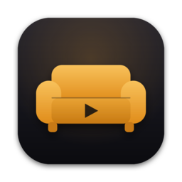
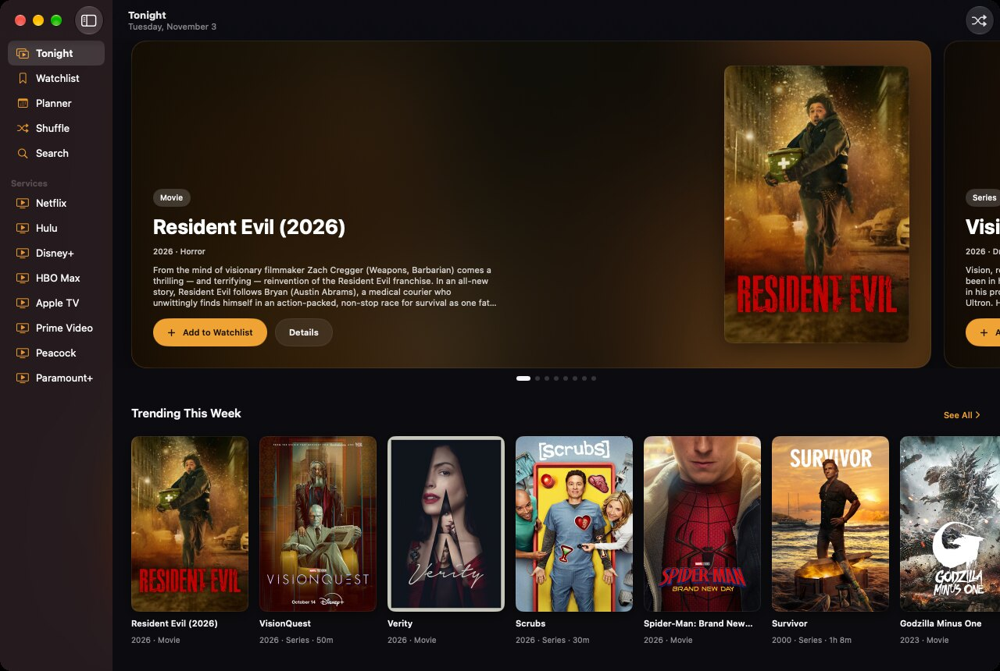
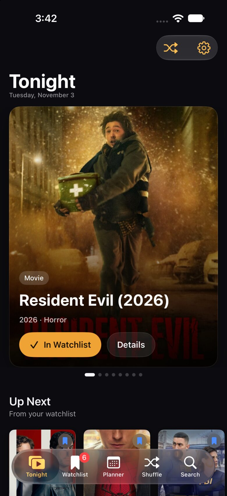
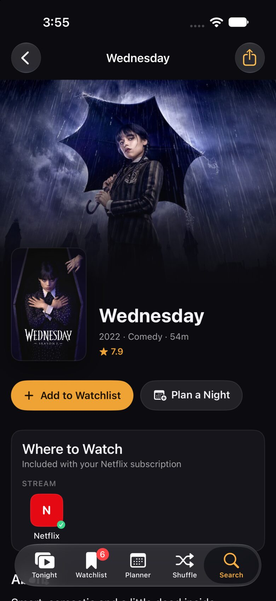
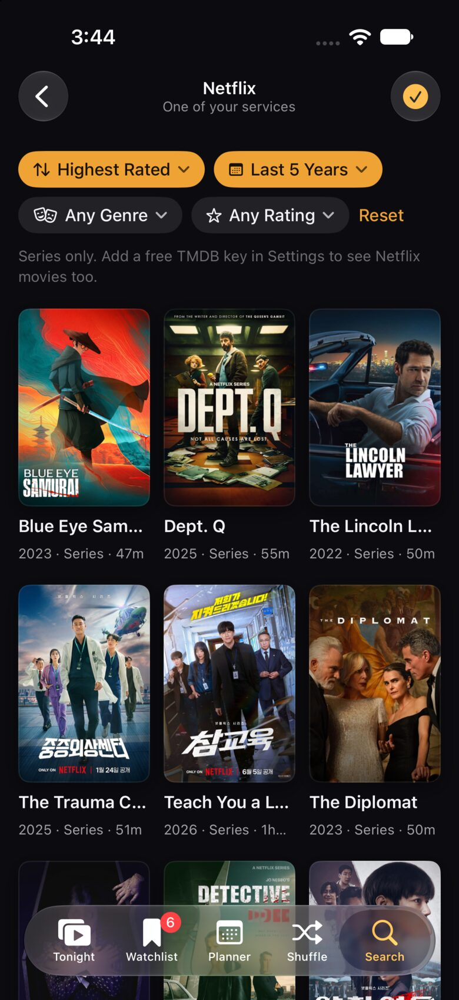
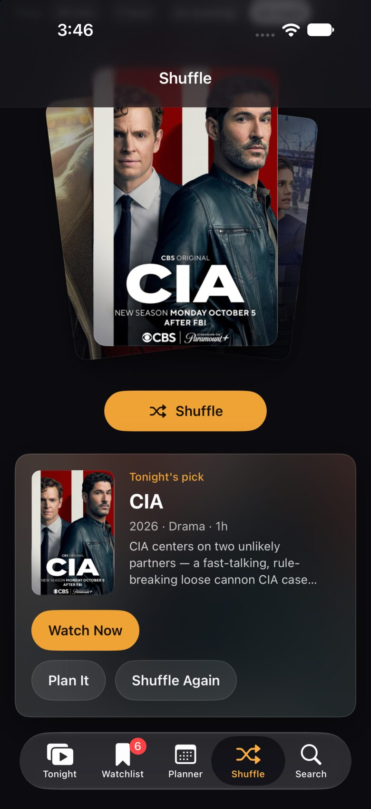
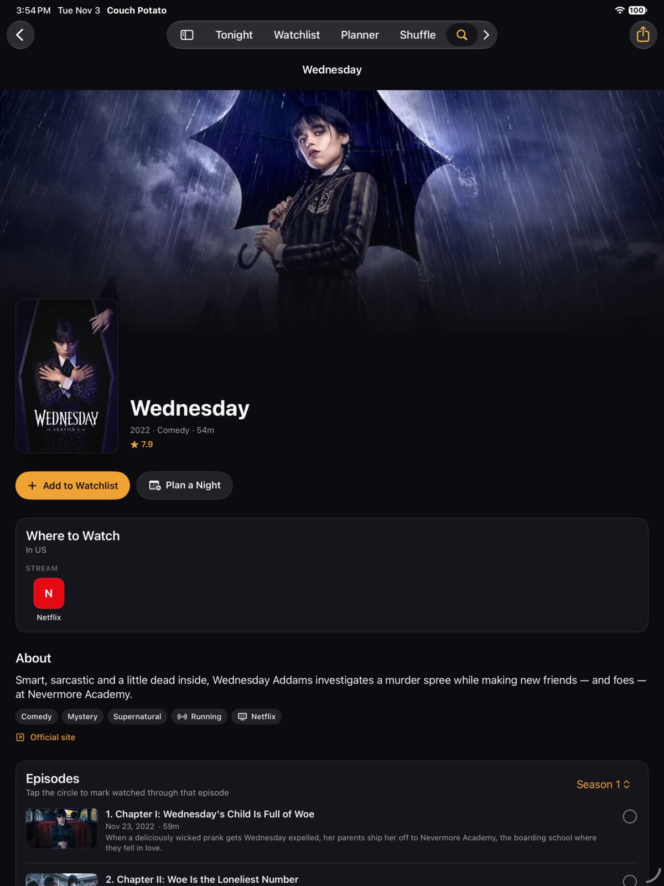
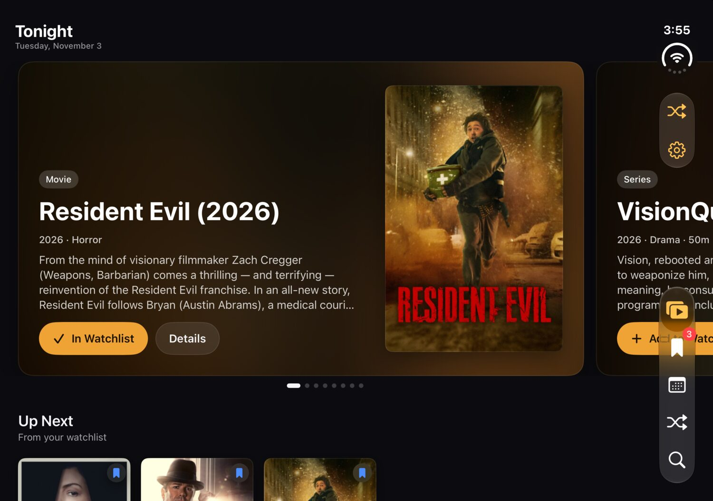
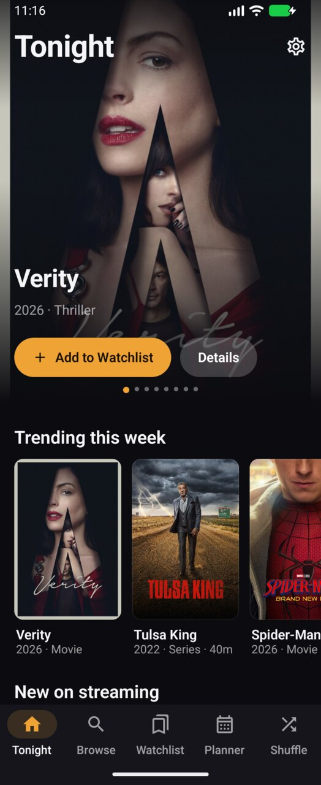

<p align="center"></p>

<h1 align="center">Couch Potato</h1>

<p align="center"><b>Everything you want to watch. One place.</b><br>
A streaming companion for iPhone, iPad, iPhone Duo, Mac and Android. It finds movies and series across Netflix, Hulu, Disney+, HBO Max, Apple TV, Prime Video, Peacock, Paramount+ and more, shows you where to stream them, and helps you plan what to watch next.</p>

<p align="center"><a href="https://nearbycoder.github.io/couch-potato/">Website</a> · <a href="#build">Build</a> · <a href="DESIGN.md">Design system</a> · <a href="https://nearbycoder.github.io/couch-potato/privacy.html">Privacy</a></p>



## Features

- **Tonight** — a home feed with a featured carousel, trending titles, new streaming arrivals, and "Popular on …" rows built from the services you subscribe to.
- **Where to Watch** — which services stream, rent or sell a title in your region. Your own services are highlighted, and one tap opens the title in that service.
- **Watchlist** — Want to Watch, Watching, Watched and Dropped, with episode-level progress, 5-star ratings and notes. Filter by service or type; sort by date, title, rating or year.
- **Planner** — schedule viewing nights on a week view, add them to your calendar, get reminders, and see upcoming episodes of the series you follow.
- **Shuffle** — can't decide? Filter by mood and time available, then let the deck pick from your watchlist or from what's trending.
- **Moods** — Cozy, Laughs, Thrills, Feels, Spooky, Brainy.
- **Sync** — every iPhone, iPad and Mac on the same iCloud account shares one library: the watchlist, ratings, progress and plans sync through iCloud (SwiftData + CloudKit), settings through iCloud key-value storage, and Handoff carries the title you're viewing between devices. Settings → iCloud Sync shows whether sync is running and when it last ran. Android keeps its library on the device (restored by Android's Google backup); **Settings → Export / Import Library** on either platform moves it between Android and Apple using the same JSON file, merging so newer changes win.

| Tonight | Title page | Filters | Shuffle |
|---|---|---|---|
|  |  |  |  |

| iPad | iPhone Duo (unfolded) | Android |
|---|---|---|
|  |  |  |

## Data sources

Couch Potato works out of the box with **no API key**:

- **[TVmaze](https://www.tvmaze.com/api)** — series, artwork, cast, episodes, air dates and the streamer or network each show airs on (CC BY-SA).
- **Apple's iTunes charts and lookup** — movie artwork, charts by genre, and Apple TV Store rent/buy prices.

Add a free **[TMDB](https://www.themoviedb.org/settings/api) key** to unlock the full catalog: every movie and series, backdrops, trailers, recommendations, and streaming availability across every provider in 17 regions (powered by JustWatch). Either paste it in **Settings → Data Sources** (on Apple devices it syncs to your other devices through iCloud) or, for the Apple build, copy `Config/Secrets.example.xcconfig` to `Config/Secrets.xcconfig` and set `TMDB_API_KEY` (that file is gitignored).

> This product uses the TMDB API but is not endorsed or certified by TMDB. Couch Potato isn't affiliated with any streaming service; service names appear as text and monograms, not logos.

## Build

### Apple (iPhone, iPad, iPhone Duo, Mac)

Requirements: Xcode 26 or later (built with Xcode 27.1), iOS/iPadOS 26+, macOS 26+, and [XcodeGen](https://github.com/yonaskolb/XcodeGen).

```sh
brew install xcodegen
git clone https://github.com/nearbycoder/couch-potato
cd couch-potato
xcodegen
open CouchPotato.xcodeproj
```

It's one multiplatform target: pick the **CouchPotato** scheme and run on an iPhone, iPad, iPhone Duo or "My Mac". iPad and Mac get a sidebar; phones get a tab bar, and the iPhone Duo uses its native side-mounted tab bar in both poses.

**iCloud sync** needs a signed build with the `iCloud.com.nearbycoder.couchpotato` CloudKit container. Set your own team in `project.yml` (`DEVELOPMENT_TEAM`), and change the bundle ID and container if you fork. Unsigned or simulator builds fall back to a local store automatically.

Tests:

```sh
xcodebuild test -project CouchPotato.xcodeproj -scheme CouchPotato \
  -destination 'platform=iOS Simulator,name=iPhone 18 Pro' CODE_SIGNING_ALLOWED=NO
```

### Android

Requirements: Android Studio (Ladybug or later) or a JDK 17+, Android SDK 37.

```sh
cd couch-potato/android
./gradlew :app:installDebug      # or open the android/ folder in Android Studio
./gradlew :app:testDebugUnitTest
```

Kotlin + Jetpack Compose + Material 3, Room, DataStore, OkHttp, Coil. Phones get a bottom bar; wide and unfolded layouts get a navigation rail.

### Deep links

Both apps open `couchpotato://title/<source>-<kind>-<id>` (for example `couchpotato://title/tmdb-movie-603` or `couchpotato://title/tvmaze-tv-44933`), plus `couchpotato://shuffle`, `couchpotato://planner` and `couchpotato://watchlist`.

## Project layout

```
CouchPotato/       SwiftUI app (App, Models, Services, Views)
CouchPotatoTests/  unit tests
android/           Kotlin / Compose app (single :app module)
design/            app icon source (SVG)
docs/              GitHub Pages site
DESIGN.md          the shared design system
```

MIT License.
