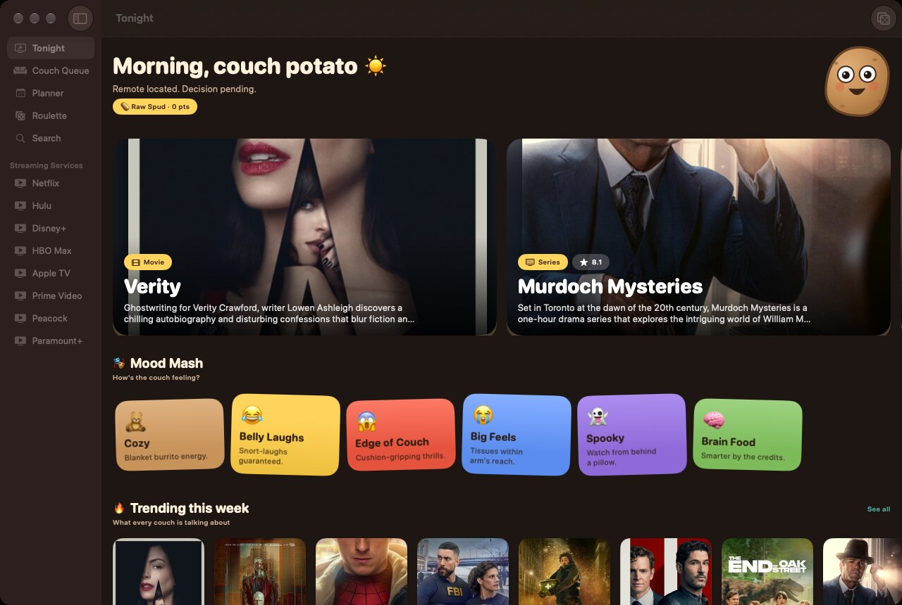
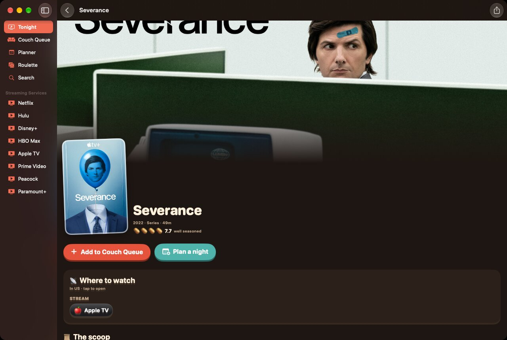
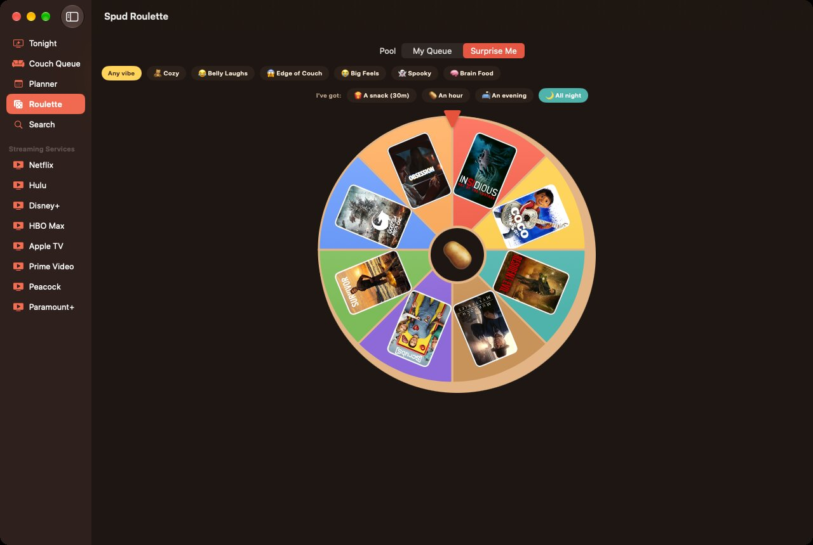

<p align="center"></p>

<h1 align="center">Couch Potato 🥔🛋️</h1>

<p align="center"><b>Your whole streaming universe, one comfy couch.</b><br>
A whimsical SwiftUI app for iPhone, iPad and Mac that finds what to watch across Netflix, Hulu, Disney+, HBO Max, Apple TV, Prime Video, Peacock, Paramount+ and more, then helps you plan it.</p>

<p align="center"><a href="https://nearbycoder.github.io/couch-potato/">Website</a> · <a href="#build-it">Build it</a> · <a href="https://nearbycoder.github.io/couch-potato/privacy.html">Privacy</a></p>



## What's on the couch

| | |
|---|---|
| **🔥 Tonight's Tater** | A home feed with a backdrop carousel, trending titles, new streaming releases, "Hot on Netflix/Hulu/…" rows built from *your* services, and popular movies and series. |
| **📡 Where to Watch** | Shows which services stream, rent or sell a title in your region. Your own services are highlighted, and one tap opens the title in that service. |
| **🛋️ Couch Queue** | A watchlist with four statuses (Want to Watch · Watching · Watched · Dropped), episode-by-episode progress, notes, and filters by service and type. |
| **📅 Spud Planner** | A week planner for couch nights. It can add them to Apple Calendar, remind you beforehand, and list upcoming episodes of shows you follow (with new-episode alerts). |
| **🎡 Spud Roulette** | Can't decide? Spin a wheel of box art built from your queue or from surprises. You can filter it by mood and by how much time you have. |
| **🎭 Mood Mash** | Cozy · Belly Laughs · Edge of Couch · Big Feels · Spooky · Brain Food. |
| **🥔 Potato Ratings & Couch Rank** | Rate titles 1–5 potatoes, and level up from Raw Spud → Tater Tot → Hash Brown → Curly Fry → Baked Legend → Mashed Royalty. |
| **☁️ iCloud Sync** | Your queue, ratings, progress and plans sync between iPhone, iPad and Mac through SwiftData + CloudKit. Settings (your services, region, TMDB key) sync through iCloud key-value storage. Handoff carries the title you're viewing between devices. |

Spud, the googly-eyed mascot, is drawn entirely in SwiftUI and blinks at you.

| Title page | Spud Roulette |
|---|---|
|  |  |

## Data sources

Couch Potato works out of the box with **no API key**:

- **[TVmaze](https://www.tvmaze.com/api)** provides series, box art, cast, episodes, air dates and which streamer or network each show is on (CC BY-SA).
- **Apple's iTunes charts and lookup** provide movie box art, charts by genre, and Apple TV Store rent/buy prices.

Add a free **[TMDB](https://www.themoviedb.org/settings/api) key** to unlock the full catalog: every movie and series, backdrops, trailers, recommendations, and streaming availability across every provider in 17 regions (powered by JustWatch). There are two ways to add it:

1. In the app: **Settings → Data sources**. The key syncs to your other devices through iCloud.
2. At build time: `cp Config/Secrets.example.xcconfig Config/Secrets.xcconfig` and fill in `TMDB_API_KEY`. That file is gitignored.

When a TMDB key is present, titles from TVmaze and Apple also get enriched with TMDB's all-provider availability.

> This product uses the TMDB API but is not endorsed or certified by TMDB. Couch Potato isn't affiliated with any streaming service. Service names appear as plain colored text chips, not logos.

## Build it

Requirements: Xcode 26+ (built with Xcode 27.1), iOS/iPadOS 18+, macOS 15+, and [XcodeGen](https://github.com/yonaskolb/XcodeGen).

```sh
brew install xcodegen
git clone https://github.com/nearbycoder/couch-potato
cd couch-potato
xcodegen
open CouchPotato.xcodeproj
```

Pick the **CouchPotato** scheme and run on an iPhone, iPad or "My Mac". It's a single multiplatform target.

**iCloud sync** needs a signed build with the `iCloud.com.nearbycoder.couchpotato` CloudKit container. Set your own team in `project.yml` (`DEVELOPMENT_TEAM`), and change the bundle ID and container if you fork. Unsigned or simulator builds fall back to a local store automatically.

Tests:

```sh
xcodebuild test -project CouchPotato.xcodeproj -scheme CouchPotato \
  -destination 'platform=iOS Simulator,name=iPhone 18 Pro' CODE_SIGNING_ALLOWED=NO
```

### Deep links

- `couchpotato://title/<source>-<kind>-<id>`, for example `couchpotato://title/tmdb-movie-603` or `couchpotato://title/tvmaze-tv-44933`
- `couchpotato://roulette`, `couchpotato://planner`, `couchpotato://queue`

## Project layout

```
CouchPotato/
  App/        entry point, root TabView (sidebar on iPad/Mac), theme, navigation model
  Models/     catalog types, providers, moods, SwiftData models (SavedTitle, CouchNight)
  Services/   TMDB / TVmaze / iTunes clients, Catalog facade, image pipeline,
              synced preferences, reminders + calendar, library helpers
  Views/      Discover, Detail, Library, Planner, Roulette, Search, Settings, Components
docs/         GitHub Pages site (nearbycoder.github.io/couch-potato)
design/       app icon source (SVG)
```

Made with butter and SwiftUI. 🧈
